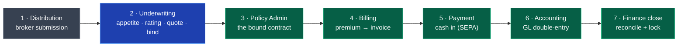

# Business Journey — contract → invoice → payment → accounting

> **One page for the end-to-end money path.** Instead of assembling it from five domain pages, this
> follows a premium from the moment a policy is bound to the moment it lands — reconciled — in the
> general ledger. Each step names the **live system**, its **status**, and a link to the detailed docs.

**Who this is for:** anyone who wants to see how the insurer's core actually works end-to-end — a new
engineer, a stakeholder, or an interviewer. For the full landscape see
[Architecture at a Glance](./architecture-at-a-glance); for authoritative live/planned status see the
[SI Delivery Board](../delivery-board).

Status legend: 🟢 live in prod · 🔵 live on dev · 🟡 partial · ⚪ planned.

## The flow

## Step by step

| # | Step | What happens | System | Status | Depth |
|---|------|--------------|--------|:------:|-------|
| 1 | **Distribution** | A broker submits a risk; it's triaged and routed to underwriting | Submission Hub (`ktayl-submission` / `ktayl-core` module) | ⚪ planned | [Submission Hub](./business-operations-tooling) |
| 2 | **Underwriting** | Appetite check → rating → quote → **bind** decision | `ktayl-underwriting` + workbench | 🔵 dev | [Underwriting](./ktayl-underwriting) · [FDE playbook](./underwriting-fde-playbook) |
| 3 | **Policy admin** | The bound **contract** exists: policy, endorsements, lifecycle | `policy` module in `ktayl-core` (ex-PAS) | 🟢 prod | [Policy Service](./ktayl-policy-service) |
| 4 | **Billing — invoice** | The bound risk becomes a **premium invoice** | `billing` module in `ktayl-core` | 🟢 prod | [Billing (ktayl-core)](./billing-ktayl-core) |
| 5 | **Payment** | Cash comes in (Stripe test SEPA direct debit) | `billing` module in `ktayl-core` | 🟢 prod | [Billing (ktayl-core)](./billing-ktayl-core) |
| 6 | **Accounting** | Premium → cash → **double-entry journal** posted to the GL | `ktayl-core` → **ERPNext** GL | 🟢 prod | [Billing (ktayl-core)](./billing-ktayl-core) |
| 7 | **Finance close** | **Reconcile** the ledger against what was billed; period close | `finance` module in `ktayl-core` | 🟢 prod | [Claims settlement & GL](./claims-settlement-gl) |

> The data handoff between steps is an **event on NATS JetStream**, never a direct DB reach-across — the
> underwriting *bound-risk* event is what billing consumes to raise the premium (the PAS itself holds no
> premium). Ownership of each business object is the [System of Record](./system-of-record).

## The claims money path (the other half)

A claim follows a parallel money path — **FNOL → adjust → reserve → settle → GL** — delivered by wrapping
the legacy core (`GlobalCore`) behind an anti-corruption layer. It too ends in the general ledger.

| Step | System | Status | Depth |
|------|--------|:------:|-------|
| Claim lifecycle (FNOL → settle) | `ktayl-claims` (ACL + CQRS + adjuster workbench) | 🟢 prod | [Legacy-core modernization](./legacy-core-modernization) |
| Settlement → GL | `ktayl-claims` → ERPNext GL | 🟢 prod | [Claims settlement & GL](./claims-settlement-gl) |

## Honest gaps

- **Step 1 (Distribution/Submission)** is not live yet — today a bound risk is created directly in
  underwriting. The broker-submission front door is planned.
- **Underwriting (step 2)** is live on **dev**, not prod — the money path is proven end-to-end on dev and
  from **Policy admin onward it is in prod**.
- Authoritative, cluster-verified status is always the [SI Delivery Board](../delivery-board), not this page.

## Related

- [Architecture at a Glance](./architecture-at-a-glance) — the full one-screen mental model
- [System of Record](./system-of-record) — who owns Policy, Premium, Claim, GL entries
- [SI Delivery Board](../delivery-board) — live vs planned, authoritative
- [Architecture Hub](/platform/architecture) — how the IS consumes the Platform
