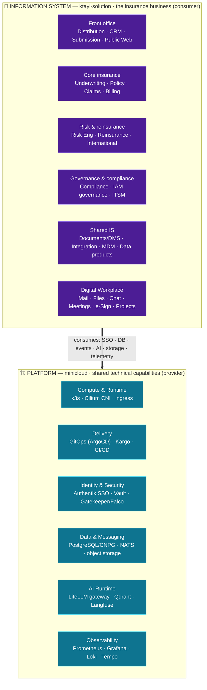

# Architecture Hub

> **One enterprise, two architectural pillars, one entry point.** This is the pillar-neutral
> navigation layer for the whole architecture — it does **not** restate the authoritative docs, it
> **links** them. Use it to move from the enterprise landscape down to applications, their platform
> dependencies, and deployments — without confusing architectural *intent* with verified *operational
> reality*.

The platform runs on a strict boundary (`platform-vs-information-system.md`), also stated in
[the two-pillar intro](../intro.md#two-pillars--pick-your-layer):

- **🏗 PLATFORM (minicloud)** — the shared **technical capabilities** (the internal cloud provider).
- **🏢 INFORMATION SYSTEM (ktayl-solution)** — the **business applications, data and processes** of the
  insurer, which *run on and consume* the platform.

The litmus test: *"If ktayl stopped selling insurance tomorrow, would this survive unchanged?"*
**Yes → Platform. No → Information System.** This is a question of **ownership, not deployment location**
— a Claims app running on Kubernetes is still an IS application.

---

## L1 — Enterprise Architecture Landscape

The one-screen relationship: the **Information System consumes the Platform**. Each box is a *group* of
capabilities/domains (drill down via the L2 views below).

The precise *who-consumes-what* (with interfaces + ownership) is the
**[Platform ↔ IS Dependency Matrix](./platform-is-dependency-matrix.md)**.

---

## Reading vocabulary (two independent axes)

Do not conflate these — they answer different questions:

| Axis | Values | Means |
|---|---|---|
| **Maturity** (does the code exist?) | **Implemented** · **Scaffold** · **Planned** | Implemented = real code + substantial functionality · Scaffold = repo/skeleton, little business logic · Planned = no implementation yet |
| **Runtime** (is it actually running?) | **Verified** · **Unverified** | Verified = runtime existence checked against the live cluster · Unverified = inferred from GitOps/repo evidence only |

:::caution Runtime status is currently Unverified
The last architecture audit could **not reach the Kubernetes cluster**, so these views assert
**implementation maturity**, not live deployment. Nothing here claims an app is "running" from the mere
existence of its repo or its ArgoCD manifest. Re-verify against the cluster before claiming operational
reality.
:::

---

## Navigation hierarchy

Enterprise Landscape → Business Capabilities → IS Applications → Platform Services → Deployment / Ops.

| View | What it answers | Authoritative? |
|---|---|---|
| **L1 — Enterprise Landscape** (above) | how Platform & IS relate | navigation |
| **[C4 System Design (Platform)](./c4-system-design.md)** | the complete platform as a C4 model — Context → Container → Deployment (Structurizr, as code) | ✅ system design |
| **[L2 — Platform Architecture / Topology](../developer-platform/29-production-stack-architecture.md)** | the platform's technical capabilities (icon topology) | ✅ platform topology |
| **[L2 — IS Application Landscape](./is-application-landscape.md)** | the business apps by insurance domain + maturity | navigation → per-app docs |
| **[Platform ↔ IS Dependency Matrix](./platform-is-dependency-matrix.md)** | consumer · capability · interface · ownership · evidence | ✅ the contract map |
| **[Enterprise Architecture Blueprint](../insurance-platform/enterprise-architecture-blueprint.md)** | the IS functional target + gap analysis | ✅ IS domains |
| **[Business Capability Map](../insurance-platform/capability-map.md)** | ~150 L2/L3 capabilities × status/criticality/RTO-RPO | ✅ capabilities |
| **[IS — Architecture at a Glance](../insurance-platform/00-architecture-at-a-glance.md)** | the IS one-screen mental model | ✅ IS overview |

**Archived reference:** the original hand-made poster is preserved at
[`/diagrams/minicloud-production-stack.html`](pathname:///diagrams/minicloud-production-stack.html)
until these views are validated, then retired. It is no longer canonical.

> **Planned:** Architecture Decision Records (ADRs) under this section — *why* ArgoCD, Authentik, Cilium,
> Longhorn, and the Platform/IS split were chosen — to show not just *what* was built but *why*.
