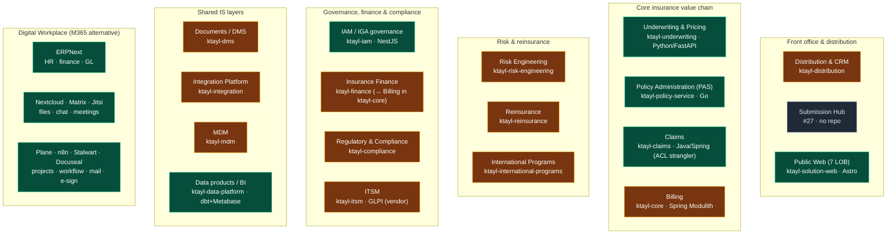

# Information System — Application Landscape (L2)

> A **navigation map** of the ktayl-solution business applications, grouped by insurance domain and
> coloured by **implementation maturity**. It is not a new source of truth — the authoritative docs are
> the **[Enterprise Architecture Blueprint](/is/insurance-platform/enterprise-architecture-blueprint)**
> (functional target + gap analysis) and the **[Business Capability Map](/is/insurance-platform/capability-map)**
> (~150 capabilities × criticality). This map helps you *find* them. Platform dependencies are in the
> **[Platform ↔ IS Dependency Matrix](./platform-is-dependency-matrix.md)**.

**Maturity legend** — 🟩 **Implemented** (real code + substantial functionality) · 🟨 **Scaffold**
(repo/skeleton, little business logic) · ⬜ **Planned** (no implementation yet).

:::caution These are maturity statuses, not runtime verification
Colours assert whether the **code** exists, **not** that the app is running. The last audit could not
reach the cluster → **runtime is Unverified** (see the [Hub vocabulary](./index.md#reading-vocabulary-two-independent-axes)).
ktayl is a **synthetic enterprise** — "implemented" never implies real production usage.
:::

## Where to go deeper (authoritative docs)

- **IS target + gaps:** [Enterprise Architecture Blueprint](/is/insurance-platform/enterprise-architecture-blueprint)
- **Capabilities × status:** [Business Capability Map](/is/insurance-platform/capability-map)
- **IS one-screen view:** [Architecture at a Glance](/is/insurance-platform/architecture-at-a-glance)
- **App catalogue:** [Business Applications Catalog](/is/insurance-platform/business-applications-catalog)
- **Digital Workplace:** [Digital Workplace Architecture](/is/is/digital-workplace-architecture)
- **Per-product boards/repos:** the `ktayl-*` repos on [github.com/andrelair-platform](https://github.com/andrelair-platform)
  (one GitHub Project per product — see the product-boards table in the governance rules).

## Why so many "Scaffold" domains?

Deliberate **modular-monolith-first + need-first** design: a business domain gets built as a **module in
`ktayl-core`** (or earns its own service only on a justified extraction), **the day its work actually
starts** — not pre-scaffolded. The empty `ktayl-*` repos define the board/boundary structure so a domain
can be built in without rework; they are *architectural stubs*, honestly marked 🟨, not abandoned code.
