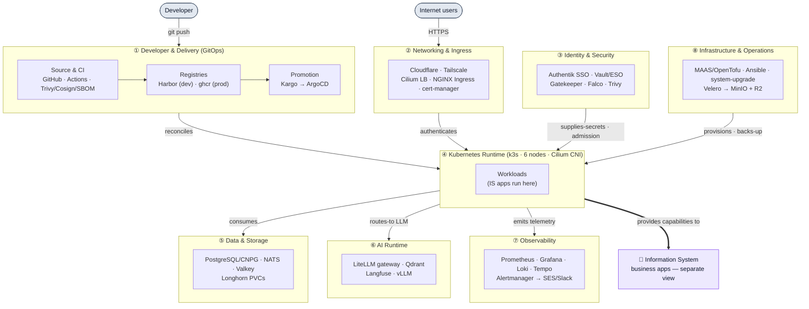

# Production Stack Architecture

**Platform Architecture** — the technical **capabilities** of the minicloud platform (6-node on-premises
k3s, 44 cores / ~84 GiB), in **three complementary, icon-rich views**: a **capability map** (understand in
30s), the detailed **technology topology** (engineering reference), and the **physical / deployment** view
(where it runs + failure domains).

:::tip Two complementary approaches — pick the right lens
These are the **icon-rich** views (mingrammer `diagrams`). For the **formal, standard-notation C4 model**
of the same platform — System Context → Container → Deployment, from a single Structurizr source — see
**[C4 System Design](../architecture/c4-system-design.md)**. The C4 page is the rigorous *model*; this page
is the *visual* reference. Same facts, different lens.
:::

:::info This view is Platform-only (by ownership, not deployment)
The **business applications** that run *on* this platform (ERPNext, the digital workplace, the custom
insurance LOB services…) are **Information-System**-owned and live in the
**[IS Application Landscape](../architecture/is-application-landscape.md)** — not here. A Claims app running
on this cluster is still an IS application. See the **[Architecture Hub](../architecture/index.md)** for how
the two pillars fit together and the [Platform ↔ IS dependency matrix](../architecture/platform-is-dependency-matrix.md).
:::

## 1. Platform Capability Architecture

The **30-second view** — the platform's **capabilities and principal flows**. Boxes are capability
*groups* (not individual products); every arrow is a **verb**.



**Legend** — boxes = platform **capability groups**; arrows = a **verb**; the **purple box = the
Information System** (business apps, a [separate view](../architecture/is-application-landscape.md)). It
answers the six questions: *how code reaches prod* (①→④), *how it's secured* (②③), *how workloads are
exposed* (②), *how secrets/data are managed* (③⑤), *how failures are detected* (⑦), and *what the platform
provides to the IS* (the final edge).

---

## 2. Platform Technology Topology (detailed reference)

The full icon topology — **generated from code**
([`platform_overview.py`](https://github.com/andrelair-platform/minicloud-platform-docs/blob/main/diagrams/src/platform_overview.py),
mingrammer `diagrams`). It's **logical** (a capability map, not a liveness claim). Preview below (PNG,
instant); open the **[▶ vector SVG →](pathname:///img/architecture/minicloud-platform.svg)** ·
**[PNG →](pathname:///img/architecture/minicloud-platform.png)** (both self-contained).

[](pathname:///img/architecture/minicloud-platform.svg)

**Legend / edge vocabulary** — **solid = principal flow** (request · delivery · routes-to) · **dashed =
backing dependency**. Verbs: *builds · pushes · promotes (CODEOWNERS PR) · reconciles · issues-certs ·
authenticates · supplies-secrets · scrapes · ships-logs/traces · backs-up · routes-to*. Cluster-wide
substrates (**Cilium** CNI+LB, **Gatekeeper** admission, **Falco** runtime) are labelled *(cluster-wide)*;
**MinIO is off-cluster** (on the MAAS controller). Every edge is verified against the GitOps manifests.

---

## 3. Platform Physical / Deployment view

Where it actually **runs** — the 6 nodes, their **roles**, **pinned** workloads, **Longhorn replication**,
and **failure domains**. Open the
**[▶ vector SVG →](pathname:///img/architecture/platform-physical.svg)** ·
**[PNG →](pathname:///img/architecture/platform-physical.png)**.

[](pathname:///img/architecture/platform-physical.svg)

**Legend** — `set-hog` is the **single control-plane** node (**control-plane SPOF**; kine/SQLite is
backed up). Workers run general/AI workloads; the **storage nodes** (fast-heron · loving-gannet ·
swift-mac) hold **Longhorn replicas**. **Vault** is pinned to fast-heron; **vLLM + Jitsi JVB** to
star-kitten. The **MAAS controller is off-cluster** (NAT · Tailscale · MinIO backup target). Longhorn is
**network-attached**, so a pod fails over to any node — the hostname labels show *current* placement, not a
hard pin.

> The original hand-made HTML poster is **preserved as an archived reference** at
> [`/diagrams/minicloud-production-stack.html`](pathname:///diagrams/minicloud-production-stack.html),
> kept until these views are validated, then retired.

---

## Platform at a Glance

| Dimension | Value |
|-----------|-------|
| Nodes | 5 ThinkPads + MacBook Pro 2012 — 44 cores / ~84 GiB (1 control-plane + 5 workers) |
| k3s version | v1.36.3+k3s1 (all 6 nodes) |
| ArgoCD apps | ~93 live applications |
| PrometheusRule objects | 53 (monitoring ns + podinfo) |
| Grafana dashboards | 43+ |
| GitOps repos | 11 (dev images → Harbor via Tailscale; prod images → ghcr.io, SHA-tagged) |
| Phases complete | 0–90 |

---

## Architecture Layers

### Access Layer

All traffic enters through a single MetalLB IP (`10.0.0.200`). Two paths:

- **Public (devandre.sbs):** Cloudflare CDN → Cloudflare Tunnel (k8s Deployment, 2 replicas, `cloudflare-tunnel` ns, anti-affinity spread across workers)
- **Internal/VPN:** Tailscale → NGINX Ingress directly via `*.10.0.0.200.nip.io`

Every application is protected by **Authentik SSO** (OIDC + TOTP) via NGINX forward-auth ingress annotations. cert-manager handles TLS for both Let's Encrypt (public) and the minicloud root CA (internal).

:::note Cloudflare Tunnel — HA since 2026-08-13
Cloudflare Tunnel moved from a controller systemd service to a 2-replica Kubernetes Deployment (PRs #678+#679). Tunnel remains active during controller reboots. SSH backup path: `controller.devandre.sbs → ssh://10.0.0.1:22` (PR #680).
:::

### GitOps & Automation

:::note Promotion is now Kargo-driven (staging retired)
The flow below is the **historical** CI-drives-promotion shape. Since 2026-08, promotion is
**trunk-based**: CI on `main` builds + proves one immutable artifact, **Kargo** promotes it
`dev → prod` (CODEOWNERS-gated), and Argo CD deploys it. The `staging` environment/branch was
removed. See the [Delivery Workflow](https://andrelair-platform.github.io/minicloud-platform-docs/developer-platform/delivery-workflow)
and Kargo pages for the current model.
:::

```
Developer push → GitHub Actions (CI)
                    ├── Build → Trivy scan → Cosign sign → syft SBOM
                    ├── Push → Harbor (via Tailscale tag:ci)
                    └── bump-gitops (GPG-signed PR) → ArgoCD auto-sync
                              │
                              ├── canary-load (parallel) — k6 5 min sustained
                              └── rollout-gate (parallel) — polls Rollout phase
                                        │
                                        └── promote-staging (needs both pass)
```

ArgoCD manages ~93 apps via the app-of-apps pattern from `minicloud-gitops`. All Helm values live in `helm-values/`, never in `minicloud-ansible/`.

**Argo Rollouts** handles progressive delivery:
- `platform-demo`: Canary 50% → AnalysisRun (Prometheus gates) → 100%
- `minicloud-plane`: BlueGreen prePromotion (health) + postPromotion (Prometheus)

### Security

| Component | Role |
|-----------|------|
| Vault (HashiCorp CE) | PKI, secrets, AWS KMS auto-unseal, fast-heron pinned |
| ESO | ExternalSecrets from Vault KV to k8s Secrets |
| Gatekeeper OPA | 18 constraints: require-non-root, no-privilege-escalation, no-hostpath, block-capabilities, require-seccomp, and more |
| Falco | Runtime syscall monitoring, DaemonSet |
| cert-manager | Let's Encrypt (public) + minicloud CA (internal) |
| Vaultwarden | Timshel fork 1.34.1-6, SSO via Authentik |
| NetworkPolicies | default-deny-ingress on all namespaces |
| kube-bench | k3s-CIS-1.7: 16/16 PASS on all workers |
| Chaos Mesh | Fault injection for Game Day reliability testing |
| cosign + SBOM | Supply-chain: every prod image (ghcr.io) is signed + has SBOM attached |

### AI / ML Platform

```
User-facing AI interfaces:
  Open WebUI (chat.devandre.sbs)  — conversational chat, RAG, model switching
  Flowise 2.2.7 (flowise.devandre.sbs) — visual LLM flow builder, no-code pipelines
    │
    └→ LiteLLM Proxy (2 replicas, KEDA auto-scale)
            ├→ vLLM v0.6.6 (Phi-3-mini, on-cluster)
            ├→ Groq API (llama-3.1-8b-instant, primary for phi3-financial)
            ├→ OpenAI text-embedding-3-small (embeddings, 1536-dim)
            ├→ DeepSeek, Mistral (cloud, via LiteLLM routes)
            └→ minicloud-agent / minicloud-crew-agent (OpenAI-compat endpoints)

RAG pipeline:
  Document → markitdown-proxy (PDF/Office/images → Markdown via Docling)
           → rag-ingest (chunk → embed → store)
           → LiteLLM → OpenAI text-embedding-3-small (1536-dim)
           → Qdrant (policy-docs, incident-reports, regulatory collections)

AI agents:
  minicloud-agent 1.0.1     — LangChain single-agent, MCP tool layer
  minicloud-crew-agent 1.0.1 — CrewAI multi-agent, insurance workflow automation

Observability:
  Langfuse: TTFT, tokens/s, cost/request, prompt eval scores, 90-day trace retention
  LiteLLM Prometheus: litellm_proxy_total_requests_metric_total, input tokens
  vLLM dashboard: vllm-inference-v1 (7 panels, ServiceMonitor in ai ns)
```

**Specialised AI services (all in `ai` namespace, managed under `litellm` ArgoCD app):**

| Service | Version | Purpose |
|---------|---------|---------|
| vLLM | v0.6.6 | GPU-optimised LLM inference (CPU on-cluster) |
| MLflow | v2.16.0-psycopg2 | Experiment tracking, model registry |
| Flowise | 2.2.7 | Visual LLM flow builder |
| minicloud-agent | 1.0.1 | LangChain agent + MCP |
| minicloud-crew-agent | 1.0.1 | CrewAI multi-agent |
| Presidio | latest | PII detection + anonymisation |
| Langfuse | 3.x | LLM observability (ClickHouse backend) |
| Open WebUI | custom | Chat interface, French BM25 RAG |
| Qdrant | 1.x | Vector store (RAG collections) |

**phi3-financial PromptOps pipeline:** routes through `groq/llama-3.1-8b-instant` (primary, weight 10) with vLLM phi3-mini as fallback. 25/25 CI eval cases pass.

### Automation & Workflows

| Service | Namespace | URL | Notes |
|---------|-----------|-----|-------|
| n8n 2.32.7 | `automation` | n8n.devandre.sbs | Phase 83, 5Gi Longhorn RWO |
| Temporal v1.31.2 | `temporal` | temporal.devandre.sbs | Phase 84, 4 historyShards (PERMANENT), PostgreSQL backend |

### Observability

The observability stack uses five complementary tools:

| Tool | Purpose | Key metric |
|------|---------|-----------|
| Prometheus | metrics collection + alerting | 53 PrometheusRule objects |
| Grafana | dashboards + explore | 43+ dashboards, TraceQL, LogQL |
| Loki | log aggregation | OTLP native, 30-day retention, LogQL ruler |
| Tempo 2.9.0 | distributed tracing | TraceQL, tracesToLogsV2, 14-day retention |
| OTel Collector | log + trace shipping | DaemonSet, OTTL transforms, replaces Promtail |
| Alertmanager | alert routing | → Stalwart:587 → SES → kanmegnea@devandre.sbs + healthchecks.io watchdog |

**Log pipeline (Gaps 1–7 closed):**
- Promtail replaced by OTel Collector DaemonSet (otelcol-contrib 0.156.0)
- OTTL `transformprocessor`: Kopia job cardinality collapsed, `level` label extracted and normalised
- Controller logs via Promtail Docker container (`--net=host` for MetalLB routing)

**SLO & Regression Detection:**
- 7 SLO objectives, 11 recording rules, burn-rate 2-tier alerts
- 5 regression alerts comparing current vs `offset 1h` baseline (latency, error rate, throughput, CPU, memory)
- `RolloutAutoRollback` alert on `argo_rollout_info{phase="Degraded"} == 1` for 1m

**Operational resilience:**
- healthchecks.io: 3 checks — Alertmanager watchdog (`cc3f232b`), controller heartbeat (`b2ac9ab5`), recovery failures (`6a37bfa6`)
- minicloud-ops: Python recovery check, 15 health probes, systemd-managed on controller

### Collaboration & Business Apps

| Service | URL | Notes |
|---------|-----|-------|
| Stalwart Mail | mail.devandre.sbs | v0.16.13, JMAP API, RocksDB |
| AWS SES | eu-west-1 | outbound relay + inbound pipeline (production approved) |
| Matrix + Element | element.devandre.sbs | Synapse v1.156.0, dedicated postgresql-synapse in `chat` ns |
| ERPNext | erp.devandre.sbs | v16.28.0, French insurance config (PCG 2025, TSCA, LOBs, Factur-X) |
| Jitsi Meet | meet.devandre.sbs | v2.21.0, JVB pinned star-kitten, TURN = Lightsail 54.171.137.209 |
| Nextcloud | files.devandre.sbs | OnlyOffice DocumentServer, SSO |
| Plane CE | plane.devandre.sbs | project management |
| Vaultwarden | vault-pw.devandre.sbs | Timshel fork (SSO button), human credential store |
| Docuseal | sign.devandre.sbs | e-Signature (eIDAS Simple), 4 insurance templates |
| Flowise | flowise.devandre.sbs | visual LLM flow builder (ai ns) |
| MLflow | mlflow.devandre.sbs | ML experiment tracking + model registry (ai ns) |
| n8n | n8n.devandre.sbs | workflow automation |
| Temporal | temporal.devandre.sbs | durable workflow engine v1.31.2 |

**Email flows (bidirectional, 2026-07-26):**
- **Outbound:** Stalwart SMTP:587 → ses-relay → SES eu-west-1 → recipient
- **Inbound:** External → MX `inbound-smtp.eu-west-1.amazonaws.com` → SES Receipt → S3 → SNS → SQS → ses-ingest pod → Stalwart → mailbox

### Storage

| Store | Location | Used by |
|-------|----------|---------|
| Longhorn | Distributed (swift-mac preferred) | All stateful workloads with RWO/RWX PVCs |
| MinIO | MAAS Controller (Docker) | Velero backup bucket, kine SQLite backups, S3-compat |
| Qdrant | `ai` ns (Longhorn PVC) | RAG vector collections (1536-dim text-embedding-3-small via OpenAI) |
| PostgreSQL-ai | `ai` ns | MLflow, LiteLLM cache, RAG metadata |
| postgresql-synapse | `chat` ns, set-hog pinned | Matrix-synapse dedicated DB (migrated 2026-08-07) |
| ClickHouse | `langfuse` ns | LLM trace storage |
| MariaDB | `erp` ns | ERPNext data |

**Backup layers:**
- **Velero (daily):** Longhorn snapshots → MinIO `velero/` bucket (local)
- **Velero off-site (weekly):** Cloudflare R2 `minicloud-velero-offsite` bucket (72h TTL)
- **kine SQLite (daily):** `sqlite3 .backup` → MinIO `k3s-backup/` + controller timer → `db-backups/kine/`

**multipathd gotcha (all 6 nodes):** IET VIRTUAL-DISK devices blacklisted in `/etc/multipath.conf` to prevent Longhorn iSCSI volumes from being claimed as `mpatha`.

---

## Hardware

| Node | IP | Role | Notes |
|------|----|------|-------|
| MAAS Controller (ThinkPad X390) | 100.88.123.8 | NAT, MAAS, Tailscale, MinIO, cloudflared systemd (SSH backup path) | 98G NVMe |
| set-hog | 10.0.0.2 | k3s control-plane | Kine/SQLite, socat proxy for scheduler+ctrl-mgr metrics |
| fast-skunk | 10.0.0.4 | k3s worker | General workloads, NVMe-first boot (BIOS) |
| fast-heron | 10.0.0.7 | k3s worker | Vault pinned (nodeSelector) |
| star-kitten | 10.0.0.8 | k3s worker (ai,worker) | Jitsi JVB pinned (hostNetwork), vLLM inference |
| loving-gannet | 10.0.0.9 | k3s worker (storage,worker) | ThinkPad T490, Longhorn replica-holding (added after original build) |
| swift-mac | 10.0.0.10 | k3s worker (storage,worker) | MacBook Pro 13" 2012, Ubuntu 22.04, Longhorn preferred |

**Boot order:** Controller (30s) → cluster nodes (2 min) → Tailscale on Mac.

**NVMe boot fix (2026-08-13):** All 5 ThinkPads boot NVMe-first. fast-skunk via BIOS; fast-heron/star-kitten/set-hog/loving-gannet via `efibootmgr --create`.

**Power failure recovery:** NAT is automated (`restore-cluster-nat.service` on controller — no manual step needed). MinIO requires a manual restart after disk-full events (caches error state in memory):
```bash
ssh controller "docker restart minio"
```

---

## Key Design Decisions

**Why on-premises?** Portfolio-grade work demonstrating infrastructure ownership, cost awareness, and operational discipline beyond managed cloud. All compute, networking, and storage decisions are explicit.

**Why app-of-apps?** Single ArgoCD application (`minicloud-gitops`) owns everything. New services are added by dropping an `apps/<name>.yaml` file — no manual ArgoCD config.

**Why a hybrid Harbor + ghcr.io registry?** Since 2026-08-27 the split is deliberate: **dev/ephemeral images live in Harbor** (on-premises via Tailscale — air-gap-capable, Trivy CVE scanning, keep-10 retention + daily GC to bound controller disk), while **prod images live in ghcr.io** (free, durable, off local disk, SHA-tagged + Cosign-signed with SBOM attached). This keeps the controller's disk budget bounded without giving up supply-chain guarantees on production artifacts.

**Why OTel Collector instead of Promtail?** Stack-agnostic — only the exporter block changes when swapping backends. OTTL transforms handle cardinality normalization and label extraction without coupling to Loki's scrape config format.

**Why Stalwart + SES instead of a managed email provider?** Full control over deliverability, DKIM rotation, and JMAP automation. SES production access (50k msg/day) eliminates sandbox restrictions at near-zero cost.

**Why Qdrant over pgvector?** Dedicated vector DB with named collections, HNSW indexing, and snapshot API. pgvector is still running in `postgresql-ai` for legacy RAG metadata; new collections use Qdrant with OpenAI `text-embedding-3-small` (1536-dim, routed via LiteLLM).

**Why Cloudflare Tunnel in k8s (not systemd)?** 2-replica Deployment with pod anti-affinity eliminates the ~90s devandre.sbs outage that occurred on every controller reboot. Cloudflare load-balances across connectors automatically.
