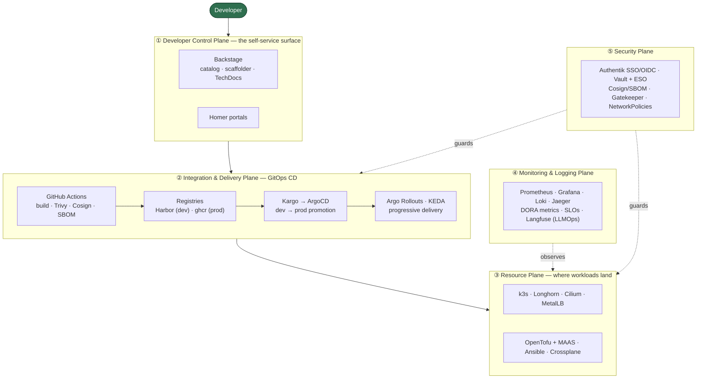

# minicloud as an Internal Developer Platform

> **minicloud is a self-hosted cloud platform that includes a full Internal Developer Platform (IDP): Backstage-fronted golden paths over GitOps continuous delivery.** This page is the *conceptual* framing — it names the platform-engineering model and maps it onto the real stack. Every component links to its own detailed page; this is the **map, not the library**.

:::info What an IDP is (and where it sits)
An **Internal Developer Platform** is a curated, **self-service** system that gives developers standardised
**golden paths** to build, deploy and operate software — combining CI/CD, IaC and container orchestration
into one layer maintained by a **platform-engineering** team, so product teams carry less cognitive load
(the [Team Topologies](https://teamtopologies.com/) *platform-as-a-service / thinnest-viable-platform* idea).

The IDP is the **platform-engineering slice of minicloud** — it is *part of* the platform, not the whole
of it (minicloud also runs the business [Information System](/is/insurance-platform/architecture-at-a-glance)
and the AI & Data platforms *on top of* this same foundation). See the boundary note at the end.
:::

---

## The five planes

Platform-engineering practice decomposes an IDP into **five planes**. minicloud implements all five with
real, running components — nothing aspirational:

| # | Plane | What it does | minicloud implementation | Detail |
|---|---|---|---|---|
| ① | **Developer control plane** | Where a developer *asks* for software, self-service | **Backstage** software catalog + scaffolder templates + TechDocs; Homer portals | [Backstage](/platform/developer-platform/backstage) · [Software Templates](/platform/developer-platform/backstage-software-templates) · [TechDocs](/platform/developer-platform/techdocs) |
| ② | **Integration & delivery plane** | Turns a commit into a running, promoted workload | GitHub Actions (build/sign/SBOM) → Harbor (dev) / ghcr (prod) → **ArgoCD** app-of-apps → **Kargo** dev→prod; Argo Rollouts + KEDA for progressive delivery | [Delivery Workflow](/platform/developer-platform/delivery-workflow) · [Kargo Promotion](/platform/developer-platform/kargo-promotion) · [Branch Strategy & CI/CD](/platform/developer-platform/branch-strategy-cicd) · [Argo Rollouts](/platform/developer-platform/argo-rollouts) |
| ③ | **Resource plane** | The compute / storage / network workloads land on | k3s (6 nodes), Longhorn, Cilium, MetalLB, MinIO, Harbor — provisioned by OpenTofu+MAAS, Ansible, Crossplane | [Production Stack Architecture](/platform/developer-platform/production-stack-architecture) · [Longhorn](/platform/storage/longhorn) · [Cilium](/platform/networking/cilium) · [Terraform/OpenTofu](/platform/iac/terraform) |
| ④ | **Monitoring & logging plane** | Observability as a paved default | Prometheus/Grafana/Alertmanager, Loki, Jaeger, **DORA metrics**, SLO dashboards; Langfuse for LLMOps | [DORA Metrics](/platform/observability/dora-metrics) · [SLO Dashboard](/platform/observability/slo-dashboard) · [Langfuse](/platform/ai-ml/langfuse) |
| ⑤ | **Security plane** | Identity + secrets + supply chain as paved road | Authentik SSO/OIDC, Vault + External Secrets Operator, Cosign + SBOM, Gatekeeper, NetworkPolicies | [SSO (Authentik)](/platform/security-enterprise/sso-authentik) · [Vault](/platform/developer-platform/vault) · [ESO + Vault](/platform/developer-platform/eso-vault) · [Cosign & SBOM](/platform/security-enterprise/cosign-sbom) |

---

## The golden paths (paved roads)

The IDP's value is not the tools — it is the **standardised, repeatable path** through them. Each paved road
below is codified (a Backstage template, a rule in the `.claude/rules` constitution, or a skill) so a
developer follows it by default instead of re-deciding every time.

| Golden path | "I want to…" | The paved road | Where it's documented |
|---|---|---|---|
| **New custom service** | ship a new stateless service | GAP **Helm wrapper-chart** (`services/<svc>/helm`) → two ArgoCD apps (dev/prod) | [New Business Service](/platform/app-deployment/new-business-service) · [Helm Chart](/platform/app-deployment/helm-chart) |
| **Promote dev → prod** | move one artifact to production safely | **Kargo** promotes one immutable image across stages; CODEOWNERS-gated prod PR; ArgoCD deploys | [Kargo Promotion](/platform/developer-platform/kargo-promotion) · [Delivery Workflow](/platform/developer-platform/delivery-workflow) |
| **Secrets** | give my app a credential | **Vault** (source of truth) → **ESO** renders the k8s Secret → pod consumes it | [ESO + Vault](/platform/developer-platform/eso-vault) |
| **SSO / identity** | put my app behind login | **Authentik** OIDC (native) or forward-auth; MFA everywhere | [SSO (Authentik)](/platform/security-enterprise/sso-authentik) |
| **An AI feature** | add an LLM-backed capability | **AI platform golden path** — LiteLLM gateway + Langfuse tracing + RAG | [AI Platform Golden Path](/platform/ai-ml/ai-platform-golden-path) · [Per-product LLMOps](/platform/ai-ml/per-product-llmops) |
| **Tests & quality** | prove it before prod | the **5-layer test pyramid** + the live QA gate before promotion | [Testing Strategy](/platform/engineering-standards/testing-strategy) |
| **Plan the work** | author a sprint of stories | **per-product BMAD** → GitHub issues + board, routed by story frontmatter | [BMAD Operating Model](/platform/engineering-standards/bmad-operating-model) |

:::tip Self-service, not ticket-ops
A developer provisions a new service, its pipeline, its secrets and its SSO **from Backstage + a Git PR** —
not by filing a ticket and waiting on an ops team. That is the IDP litmus test: *X-as-a-Service with the
platform team owning the paved road, product teams owning their product.*
:::

---

## Why it's a *full* IDP (not just "we use ArgoCD")

A CI pipeline alone is not an IDP. minicloud qualifies as a complete one because every plane is present **and
wired into a self-service surface**, with the platform run as a product:

- **Self-service surface** — Backstage catalog + scaffolder templates turn "create a service" into a form, not a runbook.
- **GitOps as the control loop** — Git is the single source of truth; ArgoCD continuously reconciles; Kargo owns promotion. Humans change *Git*, never the cluster. See the [Architecture Hub](/platform/architecture).
- **Golden paths are codified, not tribal** — the `.claude/rules` constitution + Backstage templates make the paved road the default.
- **Measured** — [DORA metrics](/platform/observability/dora-metrics) (deploy frequency, lead time, change-fail rate, MTTR) make the platform's delivery performance observable, not anecdotal.
- **Secured by default** — SSO, Vault-backed secrets, signed images + SBOMs, admission policy and network isolation are part of the path, not an afterthought.

---

## Boundary — what the IDP is *not*

:::note The IDP is a slice of minicloud, not all of it
Keep the layers distinct (the governing [platform-vs-information-system](/platform/architecture) rule):

- The **IDP** is the platform-engineering capability — the paved roads a developer uses to build & deliver software.
- The **AI Platform** and **Data Platform** are *other* platform capabilities that run on the same foundation (they are platform, but not "the IDP").
- The **Information System** ([ktayl-solution](/is/insurance-platform/architecture-at-a-glance)) — the insurance business apps — is the **consumer** of the IDP, not part of it. A Claims service built via the golden path is an *IS application that used the IDP*, not IDP itself.
- **Retrieva** (the RNCP39583 / DORA third-party-risk product) merely *runs on* this infrastructure; it is a separate product, not part of the IDP.

In one line: **minicloud *is* a self-hosted cloud platform; the IDP is its developer-facing, golden-path, GitOps-CD core.**
:::

---

## See also

- [Production Stack Architecture](/platform/developer-platform/production-stack-architecture) — the icon-rich capability + topology views of the same stack
- [C4 System Design](/platform/architecture/c4-system-design) — the formal, standard-notation model
- [Architecture Hub](/platform/architecture) — how the Platform and the Information System pillars fit together
- [Platform Engineering Backlog](/platform/platform-engineering/platform-backlog) — what's next for the platform
